<div align="center">


# Automação de Vendas — Relatório mensal de tráfego pago com IA

**Aplicativo desktop que transforma as exportações da Tray, do Google Analytics 4 e do Meta Ads em um relatório executivo de 13 páginas, com cálculos auditáveis e análises escritas pelo Gemini a partir do histórico dos meses anteriores.**


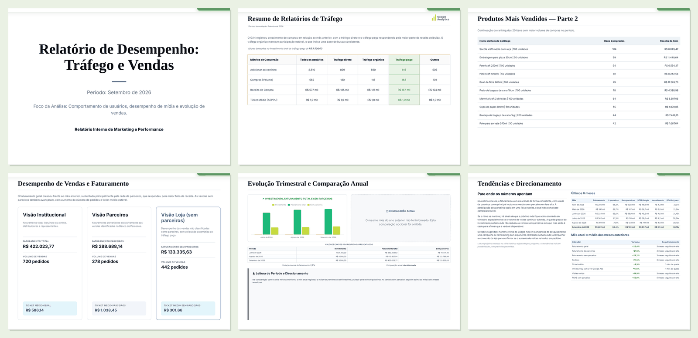

<sub>Todas as imagens usam <b>dados fictícios</b> gerados por <code>exemplos/gerar-dados-exemplo.mjs</code>.</sub>

</div>

---

## Sumário

- [O problema](#o-problema)
- [O que o programa faz](#o-que-o-programa-faz)
- [Telas](#telas)
- [Como funciona](#como-funciona)
- [Destaques técnicos](#destaques-técnicos)
- [Experimente com dados fictícios](#experimente-com-dados-fictícios)
- [Gerar o instalador do Windows](#gerar-o-instalador-do-windows)
- [Estrutura do projeto](#estrutura-do-projeto)
- [Privacidade e segurança](#privacidade-e-segurança)
- [Documentação](#documentação)
- [Roadmap](#roadmap)

## O problema

Todo mês, a equipe comercial de uma empresa de embalagens sustentáveis (e-commerce na **Tray** e vendas por uma **rede de parceiros/distribuidores**) precisava entregar à gerência um relatório de tráfego pago e vendas. O processo era manual:

- baixar **5 arquivos de 4 plataformas**, cada uma com formato, codificação e separador diferentes;
- separar, pedido a pedido, o que foi vendido para **parceiros cadastrados** e o que veio da loja;
- cruzar com o investimento em **Google Ads** e **Meta Ads** e calcular ROAS, ticket médio e variações;
- comparar com os meses anteriores e escrever as análises.

Era um processo lento e sujeito a erro. Um único problema de codificação de arquivo, por exemplo, podia esconder centenas de milhares de reais de vendas de parceiros sem que ninguém percebesse.

## O que o programa faz

| | |
|---|---|
| 📥 **Importação inteligente** | Arraste todos os arquivos do mês de uma vez. O programa identifica **pelo conteúdo** qual é cada plataforma e de qual mês são os dados, e coloca cada arquivo no lugar certo. |
| 🔤 **Leitor universal** | XLSX, XLS, CSV, TSV ou TXT, em UTF-8, Windows-1252/ISO-8859-1 ou UTF-16, com separador `;`, `,`, tab ou `|`, tudo detectado automaticamente. |
| 🧮 **Consolidação auditável** | Faturamento líquido, separação parceiros × loja, ticket médio, ROAS, ROI estimado, funil do GA4, métricas do Meta Ads e conversão da loja, com regras documentadas. |
| ✅ **Homologação automática** | Mais de 40 verificações antes de liberar o relatório: períodos de cada arquivo, coerência entre fontes, totais diários × linha TOTAL, pedidos duplicados, nomes corrompidos, investimento repetido, saltos atípicos. |
| 🧠 **Memória mensal** | Cada mês validado fica salvo com os pedidos em formato compacto. Os meses anteriores são **recalculados com o banco de parceiros atual**, sem reenviar as planilhas. |
| ✍️ **Análises com Gemini** | As 10 seções de texto são geradas em **uma única chamada**, com JSON Schema, instrução de sistema fixa e os últimos 12 meses como contexto. A IA não recalcula nada: recebe os números prontos. |
| 📈 **Tendências e direcionamento** | Médias móveis, regressão linear, sequências de alta e queda e comparação com a média alimentam uma página de leitura projetiva, sempre como possibilidade e nunca como previsão. |
| 🖨️ **Relatório de 13 páginas** | Prévia navegável e exportação em PDF pelo próprio Chromium do Electron. |
| 💾 **Aplicativo instalado** | Instalador NSIS para Windows, dados em `Documentos\`, importação da antiga versão portátil e funcionamento offline (exceto a IA). |

## Telas

<table>
<tr>
<td width="50%"><b>Arraste todos os arquivos do mês</b><br><sub>Cada arquivo é reconhecido pelo conteúdo, incluindo a codificação.</sub><br>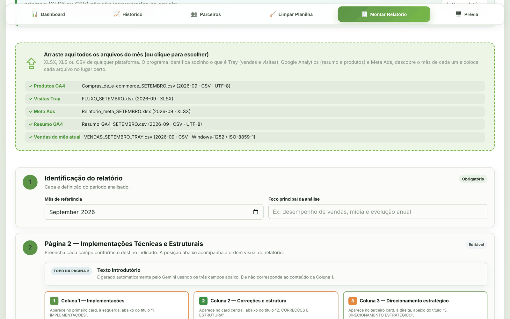</td>
<td width="50%"><b>Homologação funcional</b><br><sub>Conferência de períodos, fórmulas, cruzamentos e completude.</sub><br>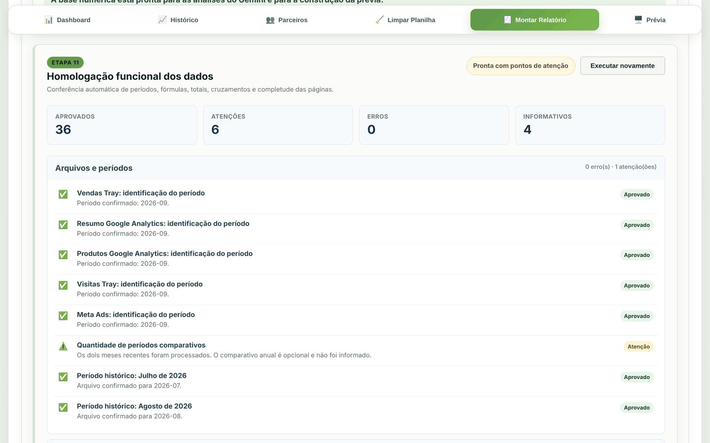</td>
</tr>
<tr>
<td><b>Análises do Gemini por seção</b><br><sub>Geradas automaticamente após a validação, todas editáveis.</sub><br>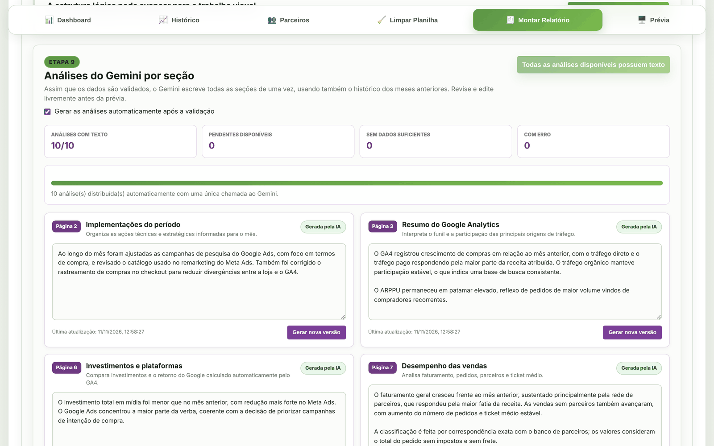</td>
<td><b>Histórico salvo pelo programa</b><br><sub>A base que a IA usa para ler tendências.</sub><br>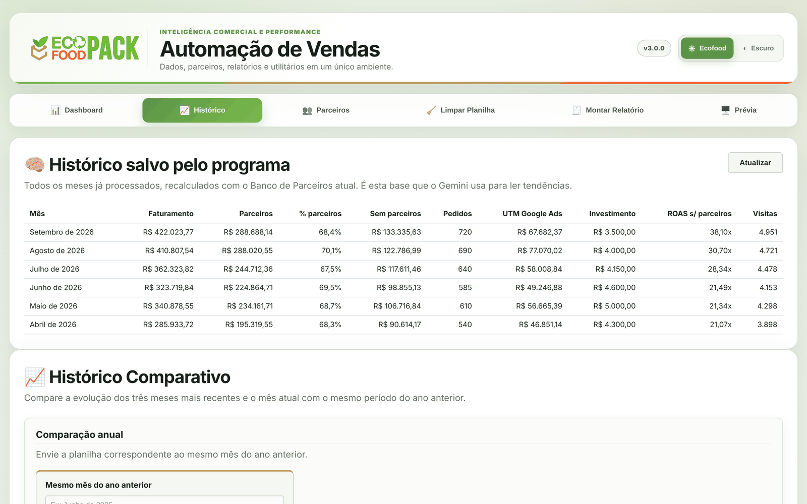</td>
</tr>
<tr>
<td><b>Consolidação e alertas</b><br></td>
<td><b>Banco de parceiros</b><br>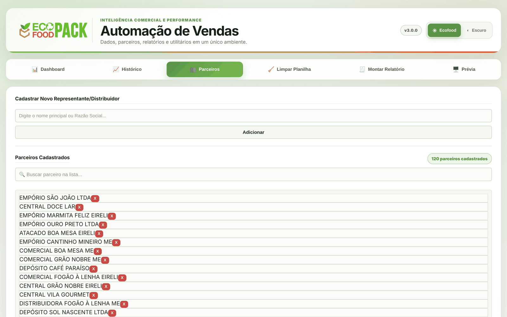</td>
</tr>
<tr>
<td><b>Prévia do relatório</b><br></td>
<td><b>Tema escuro</b><br>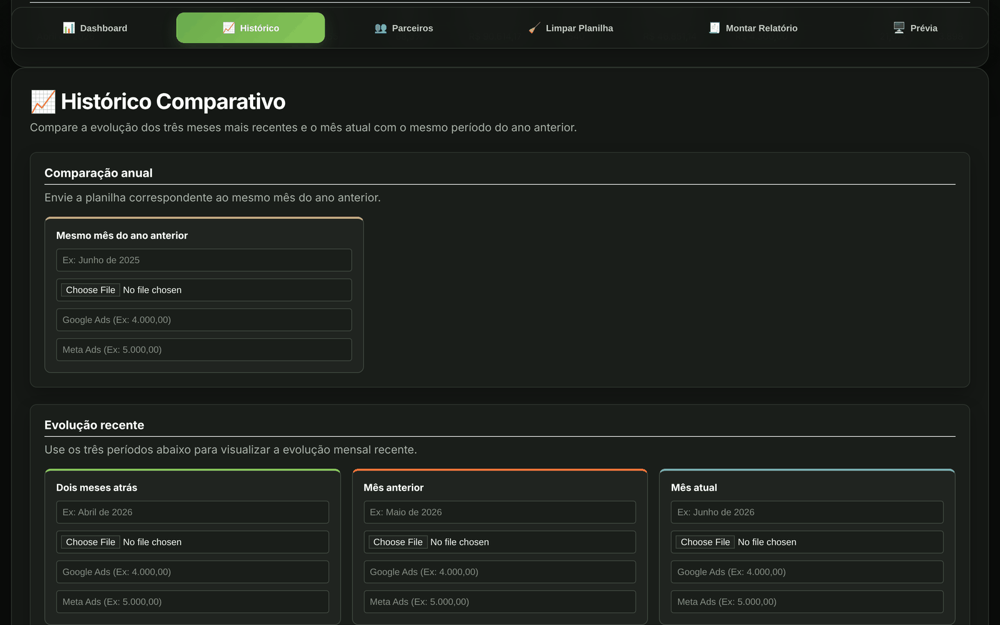</td>
</tr>
</table>

<details>
<summary><b>Ver páginas do relatório em tamanho maior</b></summary>

| Página 3 — Google Analytics | Página 7 — Vendas e faturamento |
|---|---|
| 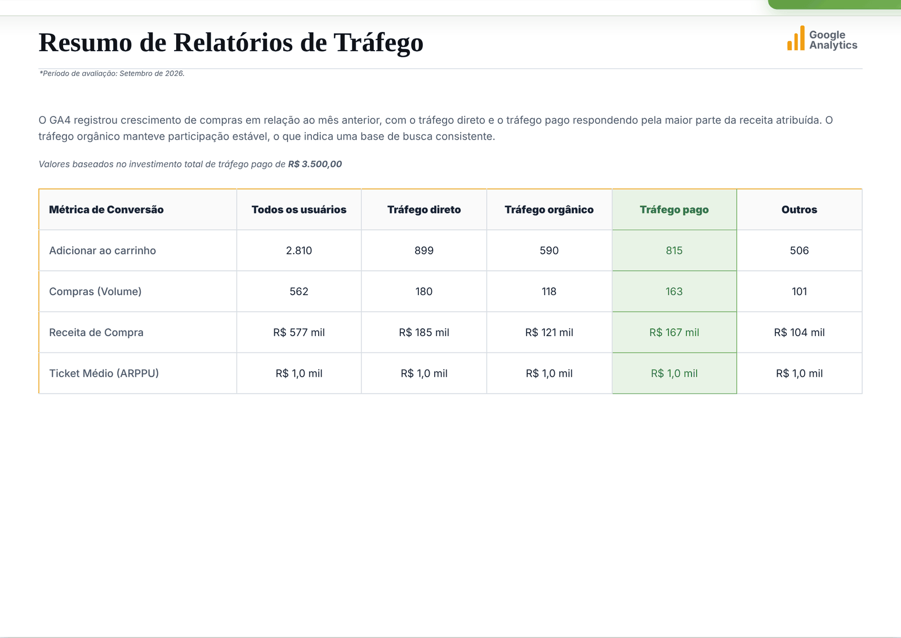 | 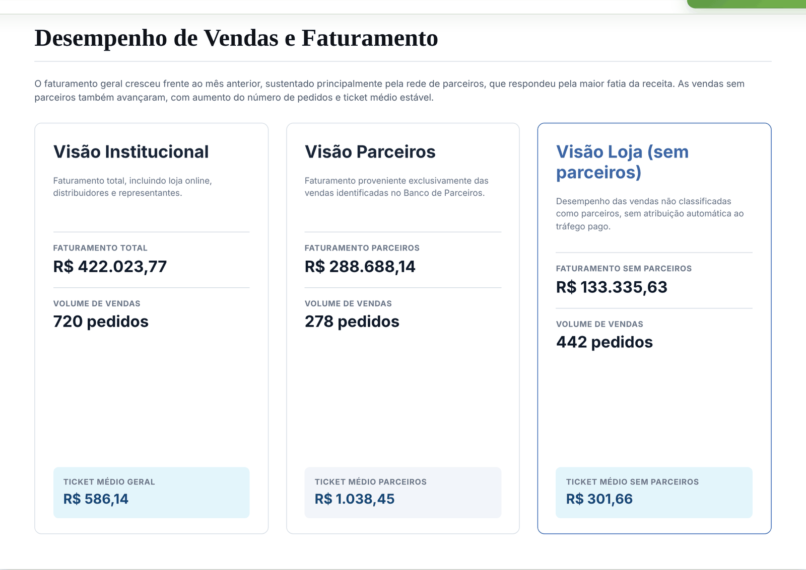 |
| **Página 10 — Evolução trimestral** | **Página 13 — Tendências e direcionamento** |
| 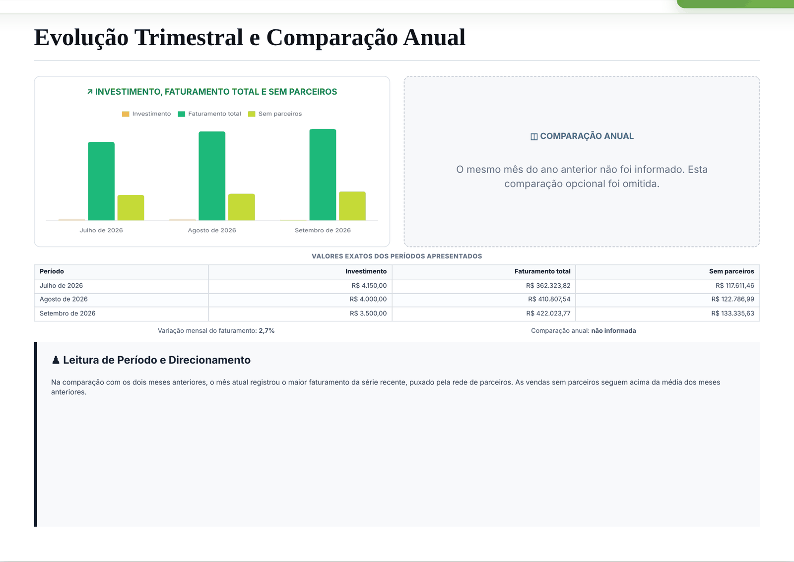 | 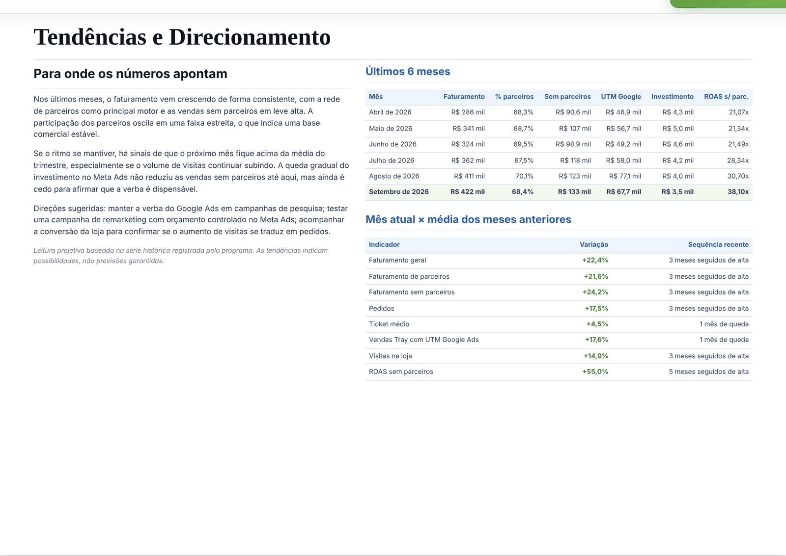 |

</details>

## Como funciona

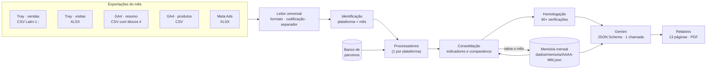

1. **Leitura** (`public/js/leitor-arquivos.js`): verifica a assinatura binária (ZIP/OLE para Excel), decodifica o texto em UTF-8 **estrito** e, se houver qualquer byte inválido, usa Windows-1252. Depois escolhe o separador mais consistente entre as linhas.
2. **Identificação**: reconhece a plataforma pelos cabeçalhos e o mês pela coluna de datas ou pelos comentários `# Data de início` do GA4.
3. **Processamento** (`public/js/processadores/`): um módulo por fonte, com conversão numérica que entende `1.234,56`, `1,234.56`, `R$` e negativos entre parênteses.
4. **Consolidação** (`public/js/relatorio/consolidacao.js`): monta a base única de indicadores e comparativos.
5. **Memória** (`public/js/relatorio/memoria.js` + `GET/PUT /api/memoria`): grava o mês e calcula série, médias e tendências.
6. **IA** (`server.js`): monta um prompt com instrução de sistema, regras, contexto por seção e JSON Schema, e repete a chamada automaticamente com espera progressiva quando o serviço responde 429 ou 503.
7. **Relatório** (`public/js/relatorio/previa-relatorio.js`): HTML paginado em A4 paisagem, exportado para PDF.

As fórmulas estão em [docs/REGRAS-DE-CALCULO.md](docs/REGRAS-DE-CALCULO.md).

## Destaques técnicos

- **Bug real encontrado em auditoria.** A Tray exporta CSV em ISO-8859-1. Lido como UTF-8, todo nome com acento virava `�` e deixava de bater com o banco de parceiros. Em um mês, isso tirava **mais de 25% do faturamento** da rede de parceiros, inflava o ROAS "sem parceiros" em mais de duas vezes e produzia análises com conclusões falsas. A correção foi a decodificação estrita com fallback, mais um alerta que conta nomes com `U+FFFD`.
- **Recalcular o passado sem as planilhas.** Cada mês guarda os pedidos como `[nome, valor líquido, data, canal, utm]` (~40 KB/mês). Quando novos parceiros são cadastrados, todos os meses anteriores são reclassificados na hora.
- **A IA não faz conta.** Todo número chega pronto, inclusive as tendências: média dos meses anteriores, média de 3 meses, inclinação percentual por regressão linear e sequência recente. O modelo só interpreta, sob regras que separam fato de hipótese.
- **Uma chamada para 10 seções.** A saída estruturada (`responseJsonSchema`) com limites de palavras por seção reduz custo e latência e mantém os números coerentes entre as seções.
- **Verificações cruzadas.** Receita dos produtos GA4 × receita do tráfego pago, soma diária de visitas × linha TOTAL, investimento digitado × valor do arquivo do Meta e participação dos parceiros com salto maior que 15 p.p. em um mês.
- **Sem framework e sem build no front-end.** HTML, CSS e ES Modules puros; as bibliotecas (SheetJS e Chart.js) vêm embutidas para funcionar offline.

## Experimente com dados fictícios

Requisitos: **Node.js 22+**.

```bash
git clone https://github.com/seu-usuario/automacao-vendas-ecofoodpack.git
cd automacao-vendas-ecofoodpack
npm install

npm run dados-exemplo   # gera parceiros, 5 meses de histórico e as planilhas de setembro (fictícios)
npm run demo            # abre em http://localhost:3000
```

1. Abra **Montar Relatório** e arraste os 5 arquivos de `exemplos/planilhas/2026-09/`.
2. Digite os investimentos (Google Ads `2.300,00` e Meta Ads `1.200,00`) e clique em **Validar e preparar**.
3. Para gerar os textos, configure uma chave gratuita do Gemini em **⚙️ Configurações** ([Google AI Studio](https://aistudio.google.com/apikey)). Sem chave, todo o resto funciona e os textos podem ser escritos à mão.

Para abrir como aplicativo desktop: `npm start`.

### Variáveis de ambiente (opcionais)

| Variável | Uso |
|---|---|
| `GEMINI_API_KEY` | Chave do Gemini (alternativa à tela de configurações) |
| `GEMINI_MODEL` | Modelo (padrão `gemini-2.5-flash`) |
| `PORT` | Porta do servidor local (padrão `3000`) |
| `AUTOMACAO_DATA_DIR` | Pasta do banco de parceiros e da memória mensal |
| `AUTOMACAO_CONFIG_DIR` | Pasta do `gemini.json` |
| `ECOFOODPACK_DADOS` | Pasta raiz de dados do aplicativo desktop |

## Gerar o instalador do Windows

```bash
npm run instalador
# → dist/Instalar-Automacao-de-Vendas-EcofoodPack-3.0.0.exe
```

O instalador cria atalhos no menu Iniciar e na Área de Trabalho e guarda os dados em `Documentos\EcofoodPack Automação de Vendas`. Na primeira abertura, ele oferece importar os dados da antiga versão portátil.

## Estrutura do projeto

```
├── desktop/                 # Processo principal do Electron (janela, menus, PDF, importação)
├── server.js                # API local (Express): parceiros, memória mensal, Gemini
├── public/
│   ├── index.html           # Interface (abas: Dashboard, Histórico, Parceiros, Relatório…)
│   ├── style.css
│   ├── vendor/              # SheetJS e Chart.js embutidos (offline)
│   └── js/
│       ├── leitor-arquivos.js       # Formato, codificação, separador e identificação
│       ├── utilitarios.js           # Conversão numérica, datas, formatação
│       ├── processadores/           # Tray (vendas, visitas), GA4 (resumo, produtos), Meta Ads
│       ├── relatorio/
│       │   ├── consolidacao.js      # Indicadores e comparativos
│       │   ├── homologacao.js       # Verificações automáticas
│       │   ├── memoria.js           # Histórico mensal, série e tendências
│       │   ├── analises-ia.js       # Contexto por seção e geração automática
│       │   └── previa-relatorio.js  # As 13 páginas
│       └── paginas/                 # Lógica de cada aba
├── exemplos/
│   ├── gerar-dados-exemplo.mjs      # Gerador de dados fictícios (semente fixa)
│   ├── iniciar-demo.cjs
│   ├── dados/                       # Parceiros e memória FICTÍCIOS
│   └── planilhas/                   # Planilhas FICTÍCIAS no formato de cada plataforma
└── docs/
```

## Privacidade e segurança

Este repositório **não contém dados reais**. As vendas, os clientes, os parceiros, os investimentos e os relatórios da empresa ficaram de fora; o que existe em `exemplos/` foi sorteado por um gerador com semente fixa.

No uso real:

- tudo roda **localmente**: o servidor escuta apenas em `127.0.0.1`;
- a chave do Gemini fica em `config/gemini.json`, fora do código e no `.gitignore`;
- para o Gemini vão **somente indicadores agregados** e textos de contexto, nunca a lista de pedidos ou nomes de clientes;
- as pastas de dados reais (`dados/`, `projetos/`, `relatorios/`, `planilhas/`, `config/`) estão no `.gitignore`.

## Documentação

- [Regras de cálculo](docs/REGRAS-DE-CALCULO.md): todas as fórmulas e critérios.
- [Formatos de arquivo](docs/FORMATOS-DE-ARQUIVO.md): o que cada plataforma exporta e como o programa reconhece.
- [Memória mensal e IA](docs/MEMORIA-E-IA.md): como o histórico alimenta o Gemini.
- [Histórico de versões](CHANGELOG.md)

## Roadmap

- [ ] Integração direta com as APIs da Tray, do GA4 e do Meta (sem exportação manual)
- [ ] Atribuição de receita do Google Ads pela UTM da Tray como critério principal
- [ ] Testes automatizados dos processadores com as planilhas de exemplo
- [ ] Painel de acompanhamento de metas mensais

## Autor

**Seu Nome**: [LinkedIn](https://www.linkedin.com/in/seu-perfil) · [GitHub](https://github.com/seu-usuario)

Projeto desenvolvido para uso interno da EcofoodPack e publicado aqui com dados fictícios. Licença [MIT](LICENSE).
